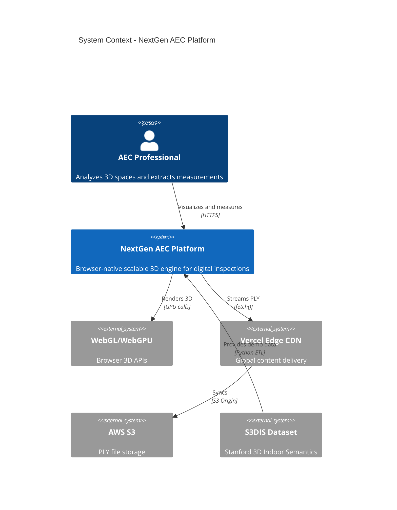
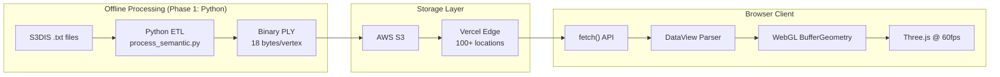

# 03. Context and Scope

**ID**: ARC42-03
**Status**: Approved
**Last Updated**: 2025-12-20

---

## Vision

NextGen AEC is a **scalable 3D engine for digital inspections and spatial analysis**. The platform enables real-time visualization of large LiDAR datasets in the browser, solving challenges that traditionally required expensive desktop software or cloud GPU infrastructure.

---

## System Context (C4 Level 1)

---

## User (Single Actor for PoC)

### AEC Professional

**Type**: Human (Web Browser)

**Description**: Architecture, Engineering, or Construction professional who needs to:
- Visualize large-scale point cloud data from LiDAR scans
- Perform digital inspections without specialized software
- Measure distances with sub-centimeter precision
- Identify and select semantic objects (chairs, tables, walls)

**Interactions**:
- Load PLY point clouds from room selector
- Navigate 3D viewport (orbit, pan, zoom, WASD)
- Select objects via raycasting
- Measure distances with Smart Ghosts
- Toggle BIM plane overlays
- Adjust quality and visual settings

**No Authentication**: PoC is public, no login required.

---

## External Systems

### SYS-001: WebGL/WebGPU (Browser APIs)

**Type**: Native Browser API

**Purpose**: GPU-accelerated 3D rendering

**Integration**: Three.js ^0.181.2 abstracts WebGL 2.0 calls

**Fallback**: WebGL 2.0 → WebGL 1.0 → Error message

**Reference**: [SYS-001_webgl-webgpu.md](systems/SYS-001_webgl-webgpu.md)

### SYS-002: LiDAR Data Source

**Type**: Offline Dataset

**Purpose**: Provide raw point cloud data for processing

**Format**: S3DIS dataset (Stanford 3D Indoor Semantics)

**Integration**: Python ETL converts .txt annotations to binary PLY (18 bytes/vertex)

**Reference**: [SYS-002_lidar-scanner.md](systems/SYS-002_lidar-scanner.md)

### SYS-003: AWS S3 / Vercel CDN

**Type**: Object Storage + Edge CDN

**Purpose**: Host and deliver processed PLY files globally

**Protocol**: HTTPS with CORS

**Caching**: Immutable (1 year max-age)

---

## Data Flow

---

## System Boundary

### Inside System (Implemented)

| Capability | Component |
|------------|-----------|
| Point cloud rendering | Three.js/R3F with custom shaders |
| Smart measurement | Smart Ghosts snap candidates |
| BIM plane overlay | Detected surfaces visualization |
| Object selection | Raycasting with highlight animation |
| Quality control | LOD via skip-rate (1/1 to 1/50) |
| Room navigation | Manifest-driven room selector |

### Outside System (PoC Scope)

| Not Implemented | Reason |
|-----------------|--------|
| User authentication | PoC is public |
| File upload | Uses pre-processed S3DIS data |
| Database persistence | Static files only |
| Real-time collaboration | Future phase |
| LAS/LAZ decompression | Binary PLY only |
| Server-side processing | Zero-compute architecture |

---

## Evolution Path

The architecture is designed for future expansion:

| Phase | Capability | Technology |
|-------|------------|------------|
| Current | Offline Python ETL | Python 3.11, Open3D |
| Phase 2 | Edge processing | Rust/WASM (10x faster) |
| Phase 3 | Streaming LOD | Octree/Potree format |
| Phase 4 | GPU analytics | WebGPU compute shaders |

See [ROADMAP.md](../../docs/ROADMAP.md) for detailed migration plan.

---

**Previous**: [02. Constraints](../02_constraints/002_constraints.md) | **Next**: [04. Solution Strategy](../04_solution-strategy/stack.md)
