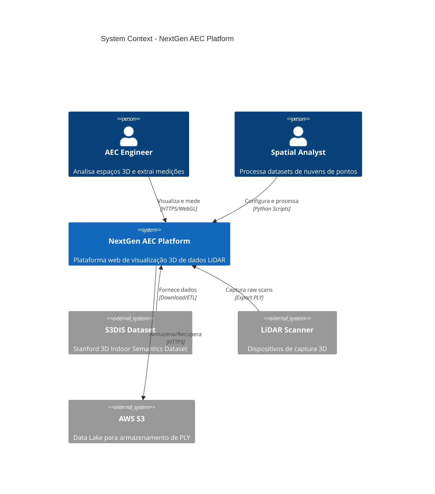
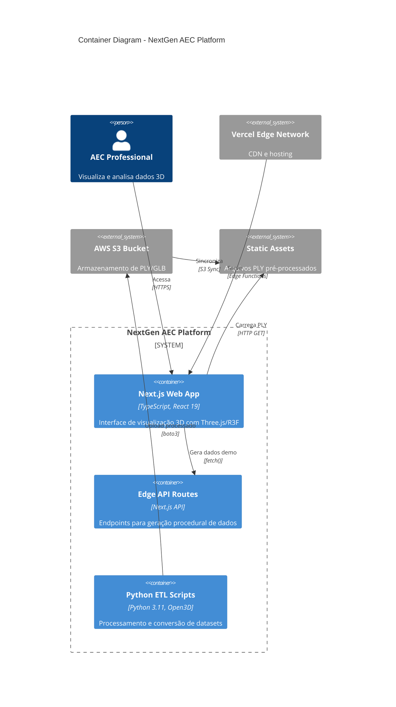
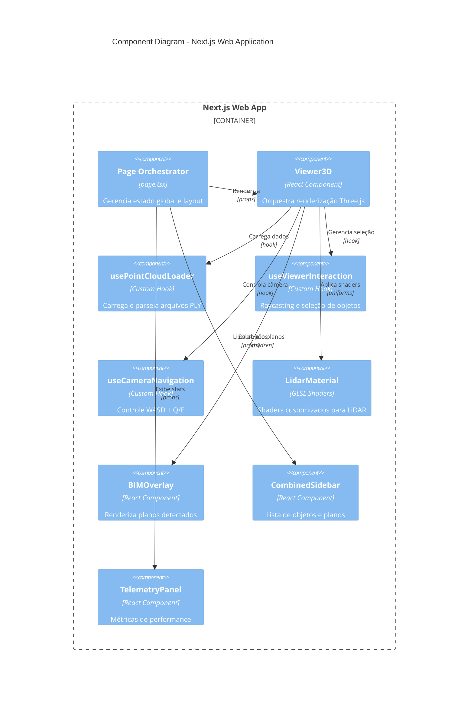
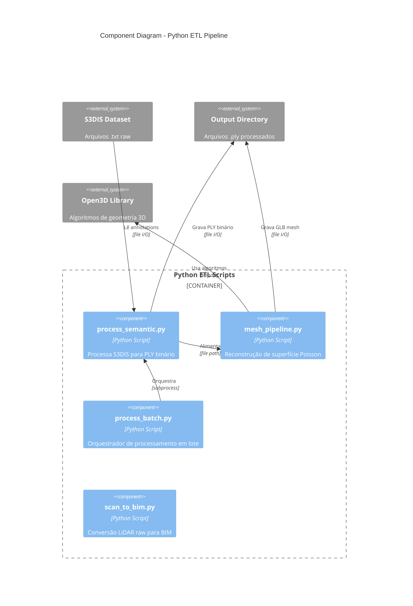
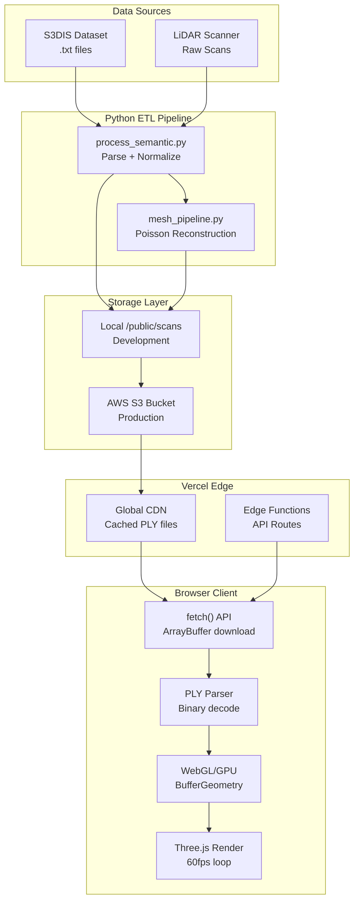
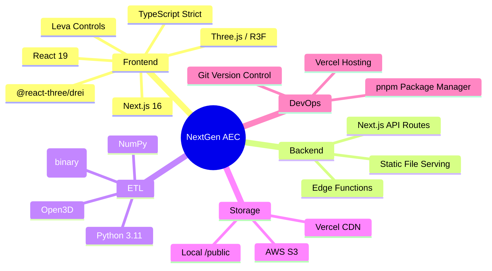

# 05. Building Block View - Whitebox Overall System

**Version**: 1.0.0
**Last Updated**: 2025-12-20
**Status**: Approved

---

## 1. System Context (C4 Level 1)

O NextGen AEC Platform opera em um ecossistema híbrido que conecta processamento offline de dados LiDAR com visualização em tempo real no navegador.

---

## 2. Container Diagram (C4 Level 2)

---

## 3. Component Diagram - Frontend (C4 Level 3)

---

## 4. Component Diagram - ETL Pipeline (C4 Level 3)

---

## 5. Data Flow Architecture

---

## 6. Building Block Responsibilities

### 6.1 Frontend Components

| Building Block | Responsabilidade | Interfaces | Dependências |
|----------------|------------------|------------|--------------|
| **page.tsx** | Orquestração de estado global | useState, useEffect | Viewer3D, Sidebar, Header |
| **Viewer3D** | Container da cena 3D | props: fileUrl, callbacks | usePointCloudLoader, Three.js |
| **usePointCloudLoader** | Download e parsing de PLY | return: bufferGeometry, stats | fetch API, DataView |
| **useViewerInteraction** | Raycasting e seleção | return: hoveredId, selectedId | THREE.Raycaster |
| **LidarMaterial** | Shaders GLSL customizados | uniforms: uSelectedId, uTime | ShaderMaterial |
| **BIMOverlay** | Renderização de planos BIM | props: roomName, bounds | @react-three/drei |

### 6.2 ETL Components

| Building Block | Responsabilidade | Input | Output |
|----------------|------------------|-------|--------|
| **process_semantic.py** | Converter S3DIS para PLY binário | .txt annotations | .ply (18 bytes/vertex) |
| **mesh_pipeline.py** | Reconstrução de superfície | .ply point cloud | .glb mesh |
| **process_batch.py** | Processamento paralelo | Directory path | Multiple .ply files |
| **scan_to_bim.py** | Extração de planos | Raw LiDAR | BIM-compatible format |

---

## 7. Technology Stack Overview

---

## 8. Cross-Cutting Concerns

### 8.1 Performance

- **LOD (Level of Detail)**: Skip-rate de 1/50 para qualidade baixa
- **Raycasting Throttle**: 4fps (250ms) para evitar travamentos
- **Memory Cache**: PLY raw mantido em `rawDataRef` para re-processamento

### 8.2 Type Safety

- TypeScript strict mode em todo o frontend
- Interfaces centralizadas em `types/index.ts`
- Validação de bounds e null-checks em hooks

### 8.3 Error Handling

- Try-catch em operações de I/O (fetch, parse)
- Toast notifications para feedback de erro
- Fallback para dados demo quando PLY falha

---

## 9. Quality Attributes

| Atributo | Mecanismo | Building Block |
|----------|-----------|----------------|
| **Performance** | LOD + Shader optimization | usePointCloudLoader, LidarMaterial |
| **Usability** | Real-time controls + tooltips | Leva, ToastContext |
| **Reliability** | Cached raw data + error handling | usePointCloudLoader |
| **Maintainability** | Feature-based organization | /features/viewer, /features/ui |
| **Portability** | Web standards (WebGL, fetch) | All frontend components |

---

## 10. Related Documentation

- [04. Solution Strategy](../04_solution-strategy/stack.md) - Technology decisions
- [06. Runtime View](../06_runtime/scenarios/) - Runtime scenarios
- [08. Technical Concepts](../08_concepts/01_technical_decisions.md) - Design patterns

---

**Document Owner**: Lead Software Architect
**Review Cycle**: Quarterly
**Next Review**: 2026-03-20
