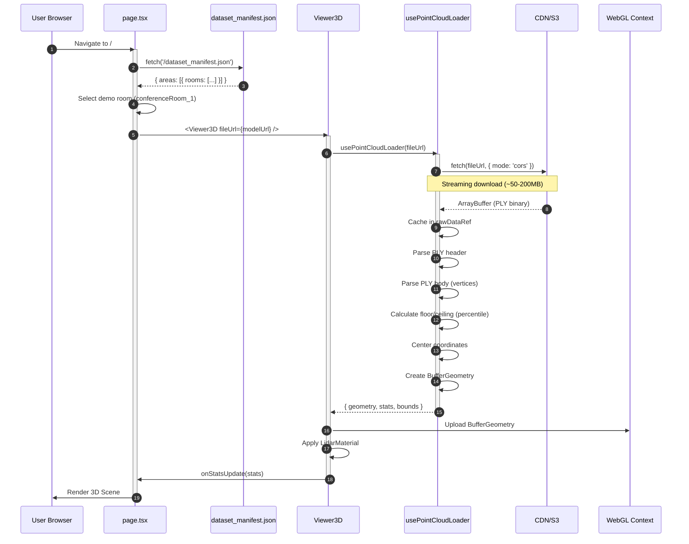
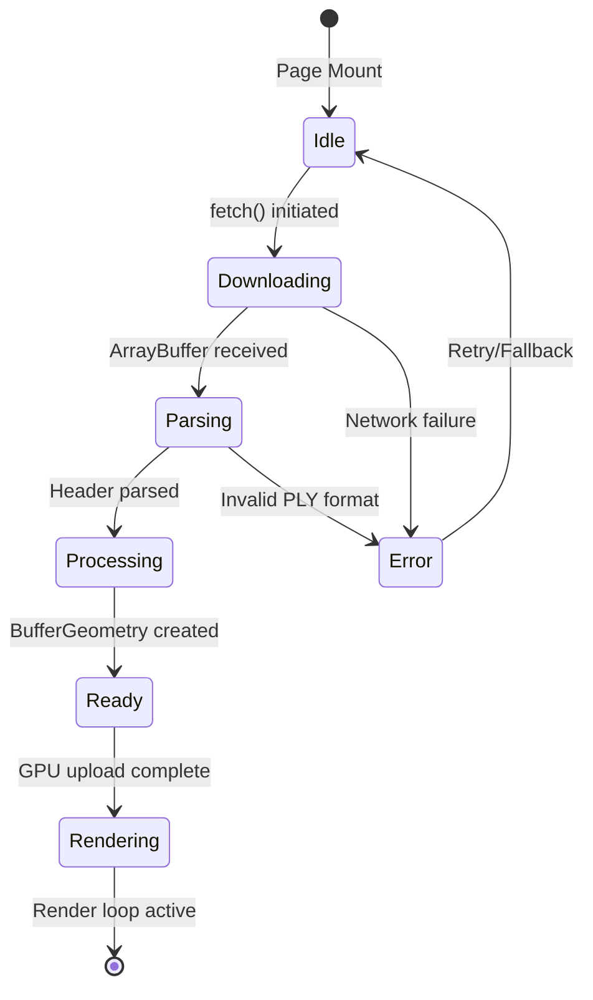
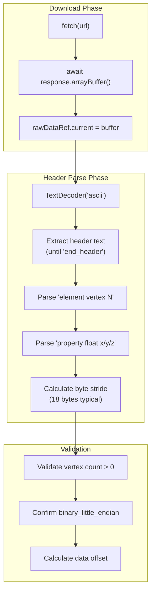
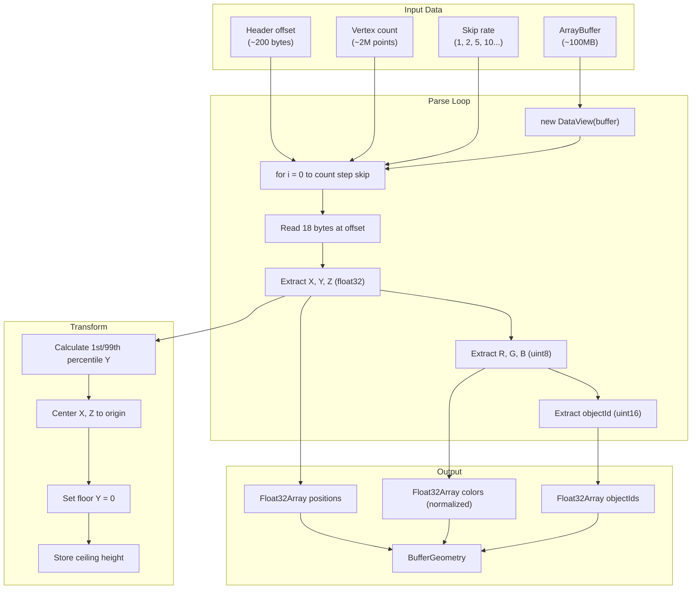
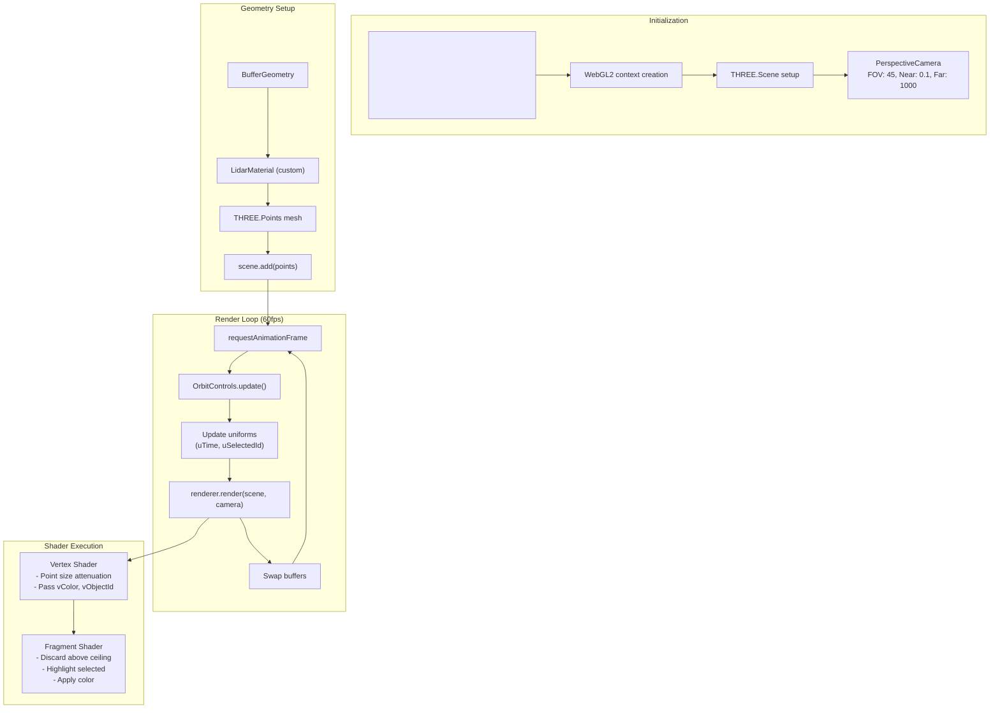
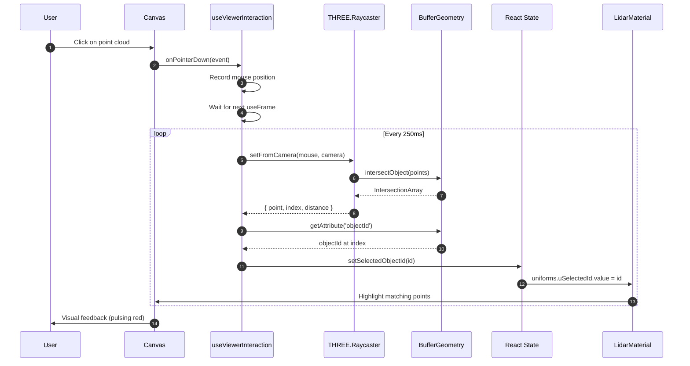
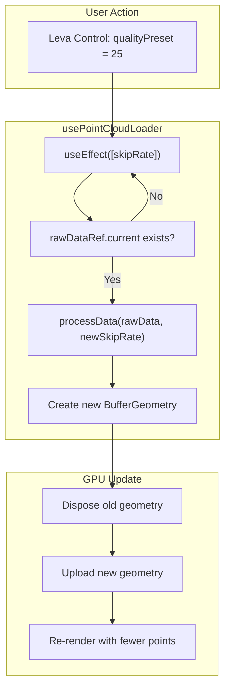
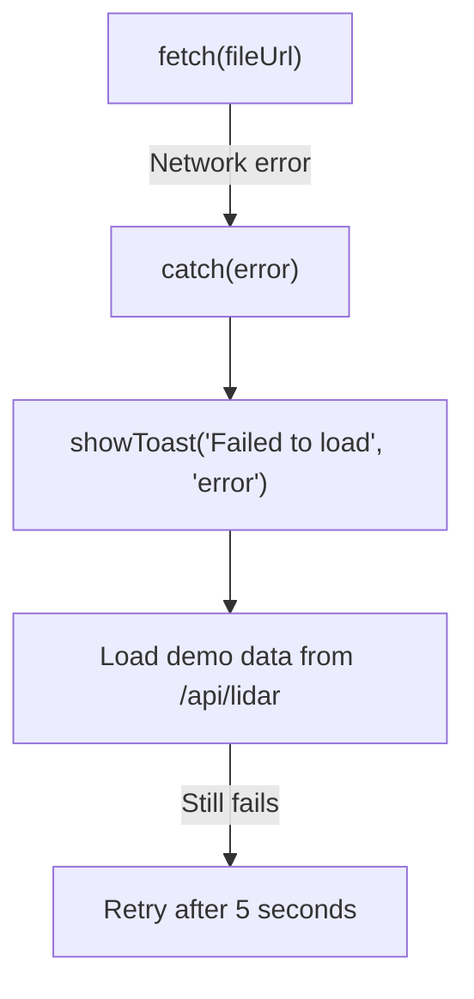

# 06. Runtime View - Critical Scenarios

**Version**: 1.0.0
**Last Updated**: 2025-12-20
**Status**: Approved

---

## 1. Overview

Este documento descreve os cenários de runtime críticos do NextGen AEC Platform, detalhando o fluxo de dados, interações entre componentes e estados do sistema durante a execução.

---

## 2. Scenario 01: User Opens Viewer

### 2.1 Sequence Diagram



### 2.2 Step-by-Step Flow

| Step | Component | Action | Duration |
|------|-----------|--------|----------|
| 1 | Browser | Navega para `/` | - |
| 2 | page.tsx | Monta e inicia fetch do manifest | ~50ms |
| 3 | page.tsx | Parseia manifest e seleciona room | ~10ms |
| 4 | Viewer3D | Recebe `fileUrl` via props | - |
| 5 | usePointCloudLoader | Inicia download do PLY | ~2-10s (rede) |
| 6 | usePointCloudLoader | Cache do ArrayBuffer em memória | ~100ms |
| 7 | usePointCloudLoader | Parse do header (count, stride) | ~5ms |
| 8 | usePointCloudLoader | Parse do body (vertices loop) | ~500ms-2s |
| 9 | usePointCloudLoader | Cálculo de bounds (1st/99th percentile) | ~100ms |
| 10 | usePointCloudLoader | Centralização de coordenadas | ~50ms |
| 11 | usePointCloudLoader | Criação do BufferGeometry | ~100ms |
| 12 | WebGL | Upload para GPU VRAM | ~200ms |
| 13 | Viewer3D | Aplicação do LidarMaterial | ~10ms |
| 14 | page.tsx | Atualização de stats no TelemetryPanel | ~5ms |
| 15 | Render Loop | Primeiro frame renderizado | ~16ms |

### 2.3 State Transitions



---

## 3. Scenario 02: Fetcher Downloads PLY Header

### 3.1 Header Parsing Detail



### 3.2 PLY Header Example

```
ply
format binary_little_endian 1.0
element vertex 2847593
property float x
property float y
property float z
property uchar red
property uchar green
property uchar blue
property uchar label
property uint16 objectId
end_header
```

### 3.3 Binary Layout

```
Offset 0-3:   float32 X coordinate (Little Endian)
Offset 4-7:   float32 Y coordinate
Offset 8-11:  float32 Z coordinate
Offset 12:    uint8 Red (0-255)
Offset 13:    uint8 Green (0-255)
Offset 14:    uint8 Blue (0-255)
Offset 15:    uint8 Semantic Label (0-13)
Offset 16-17: uint16 Object ID (0-65535)
-------------------------------------------
Total: 18 bytes per vertex
```

---

## 4. Scenario 03: Worker Parses PLY Data

### 4.1 Parsing Algorithm



### 4.2 Code Flow (usePointCloudLoader)

```typescript
// Phase 1: Download
const response = await fetch(fileUrl);
const buffer = await response.arrayBuffer();
rawDataRef.current = buffer; // Cache for quality changes

// Phase 2: Parse Header
const headerText = new TextDecoder('ascii').decode(buffer.slice(0, 1000));
const vertexMatch = headerText.match(/element vertex (\d+)/);
const vertexCount = parseInt(vertexMatch[1]);
const headerEndIndex = headerText.indexOf('end_header') + 11;

// Phase 3: Parse Body
const dataView = new DataView(buffer, headerEndIndex);
const stride = 18; // bytes per vertex
const skipRate = qualityPreset;
const outputCount = Math.floor(vertexCount / skipRate);

const positions = new Float32Array(outputCount * 3);
const colors = new Float32Array(outputCount * 3);
const objectIds = new Float32Array(outputCount);

for (let i = 0, j = 0; i < vertexCount; i += skipRate, j++) {
  const offset = i * stride;
  positions[j * 3] = dataView.getFloat32(offset, true);     // X
  positions[j * 3 + 1] = dataView.getFloat32(offset + 4, true); // Y
  positions[j * 3 + 2] = dataView.getFloat32(offset + 8, true); // Z
  colors[j * 3] = dataView.getUint8(offset + 12) / 255;     // R
  colors[j * 3 + 1] = dataView.getUint8(offset + 13) / 255; // G
  colors[j * 3 + 2] = dataView.getUint8(offset + 14) / 255; // B
  objectIds[j] = dataView.getUint16(offset + 16, true);     // ID
}

// Phase 4: Create Geometry
const geometry = new THREE.BufferGeometry();
geometry.setAttribute('position', new THREE.BufferAttribute(positions, 3));
geometry.setAttribute('color', new THREE.BufferAttribute(colors, 3));
geometry.setAttribute('objectId', new THREE.BufferAttribute(objectIds, 1));
```

---

## 5. Scenario 04: Render Loop Initialization

### 5.1 Render Pipeline



### 5.2 LidarMaterial Uniforms

```typescript
uniforms: {
  uTime: { value: 0 },              // Animation clock
  uSelectedId: { value: -1 },       // Highlighted object
  uCutoff: { value: 50 },           // Ceiling Y clipping
  uPointSize: { value: 0.02 },      // Base point size
  uOpacity: { value: 1.0 },         // Global opacity
  uSplatTexture: { value: null }    // Optional splat texture
}
```

### 5.3 Frame Timing Budget

```
Target: 60 FPS (16.67ms per frame)

Phase Breakdown:
├── JavaScript Logic:     ~2ms
│   ├── useFrame hooks:   ~1ms
│   ├── Raycasting:       ~0.5ms (throttled to 4fps)
│   └── State updates:    ~0.5ms
├── GPU Rendering:        ~10-12ms
│   ├── Vertex shader:    ~3ms (per 1M points)
│   ├── Fragment shader:  ~5ms (with discard)
│   └── Blending/Output:  ~2ms
└── Idle/Swap:            ~2-4ms
```

---

## 6. Scenario 05: Object Selection via Raycasting

### 6.1 Interaction Flow



### 6.2 Raycasting Optimization

```typescript
// Throttle raycasting to 4fps
const RAYCAST_INTERVAL = 0.25; // seconds
let timeSinceLastRaycast = 0;

useFrame((_, delta) => {
  timeSinceLastRaycast += delta;
  if (timeSinceLastRaycast < RAYCAST_INTERVAL) return;
  timeSinceLastRaycast = 0;

  // Skip if mouse hasn't moved
  if (Math.abs(mouse.x - lastMouse.x) < 0.01 &&
      Math.abs(mouse.y - lastMouse.y) < 0.01) return;

  raycaster.setFromCamera(mouse, camera);
  raycaster.params.Points.threshold = 0.05; // Hit tolerance

  const intersects = raycaster.intersectObject(pointsRef.current, false);
  if (intersects.length > 0) {
    const hit = intersects[0];
    const objectId = geometry.attributes.objectId.getX(hit.index);
    onObjectHover(objectId);
  }
});
```

---

## 7. Scenario 06: Quality Preset Change

### 7.1 Re-processing Flow



### 7.2 Performance Comparison

| Quality Preset | Skip Rate | Points (2M original) | GPU Memory | FPS |
|----------------|-----------|----------------------|------------|-----|
| 1 (Ultra) | 1 | 2,000,000 | ~150MB | 30-45 |
| 2 (High) | 2 | 1,000,000 | ~75MB | 45-55 |
| 5 (Medium) | 5 | 400,000 | ~30MB | 55-60 |
| 10 (Low) | 10 | 200,000 | ~15MB | 60 |
| 25 (Very Low) | 25 | 80,000 | ~6MB | 60 |
| 50 (Minimal) | 50 | 40,000 | ~3MB | 60 |

---

## 8. Error Handling Scenarios

### 8.1 Network Failure



### 8.2 Invalid PLY Format

```typescript
try {
  const headerText = decoder.decode(buffer.slice(0, 1000));
  if (!headerText.startsWith('ply')) {
    throw new Error('Invalid PLY magic number');
  }
  if (!headerText.includes('binary_little_endian')) {
    throw new Error('Only binary little-endian PLY supported');
  }
} catch (error) {
  console.error('PLY parse error:', error);
  showToast(`Failed to parse PLY: ${error.message}`, 'error');
  setLoading(false);
}
```

---

## 9. Performance Monitoring

### 9.1 Telemetry Metrics

```typescript
interface ViewerStats {
  points: number;       // Loaded point count
  width: number;        // X extent (meters)
  height: number;       // Y extent (meters)
  depth: number;        // Z extent (meters)
  area: number;         // Floor area (m²)
  volume: number;       // Room volume (m³)
  fps: number;          // Render FPS
  drawCalls: number;    // Always 1 for point cloud
  memory: number;       // Estimated GPU memory (MB)
}
```

### 9.2 FPS Tracking

```typescript
useFrame((state) => {
  frameCount++;
  const elapsed = state.clock.getElapsedTime() - lastFpsTime;
  if (elapsed >= 1.0) {
    const fps = Math.round(frameCount / elapsed);
    onStatsUpdate({ ...stats, fps });
    frameCount = 0;
    lastFpsTime = state.clock.getElapsedTime();
  }
});
```

---

## 10. Related Documentation

- [05. Building Block View](../05_building-block-view/01_whitebox_overall.md) - Component architecture
- [08. Technical Concepts](../08_concepts/01_technical_decisions.md) - Design patterns
- [BDD Scenario: LiDAR Viewer](scenarios/lidar_viewer.md) - User story format

---

**Document Owner**: Lead Software Architect
**Review Cycle**: Quarterly
**Next Review**: 2026-03-20
