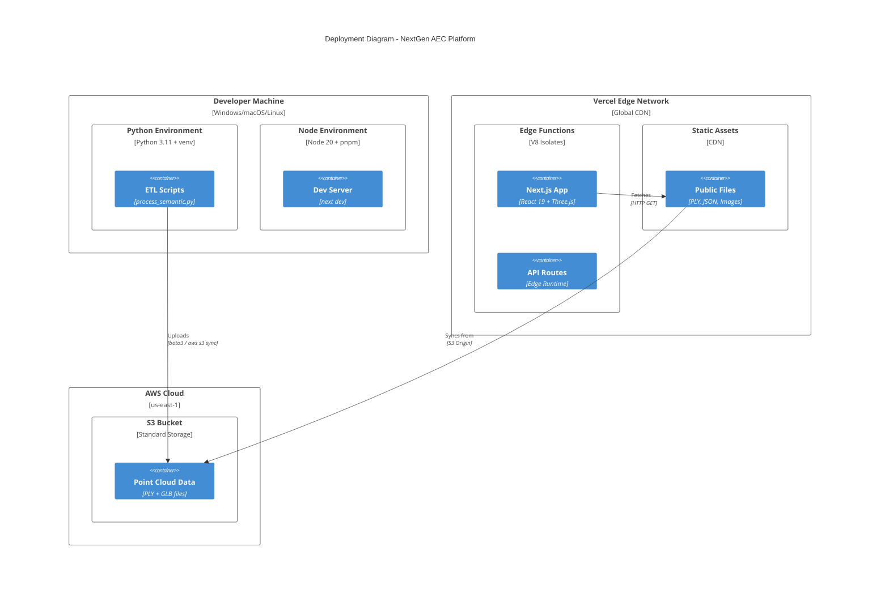
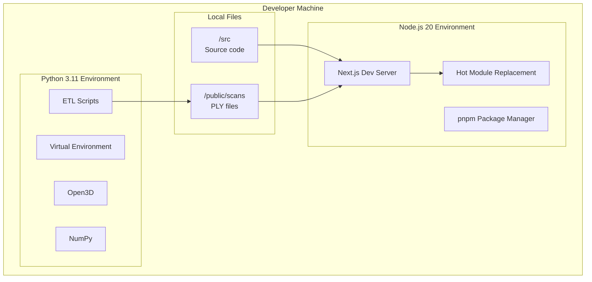
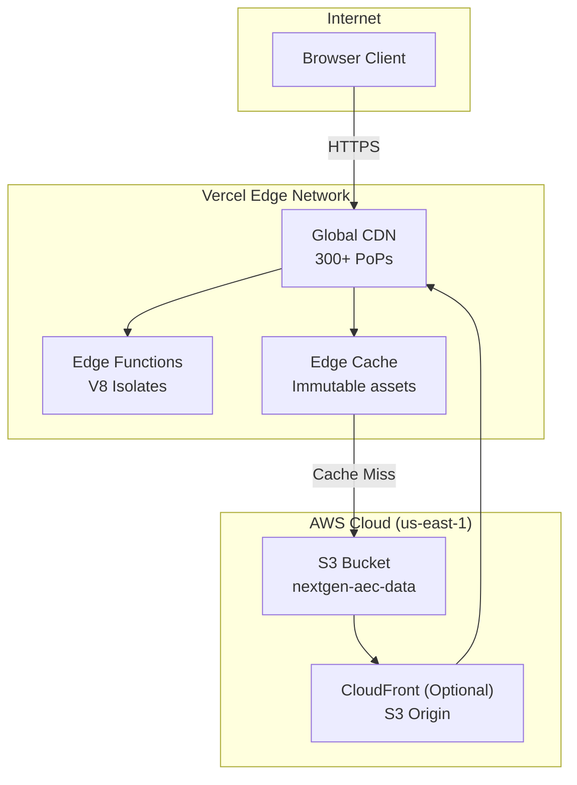
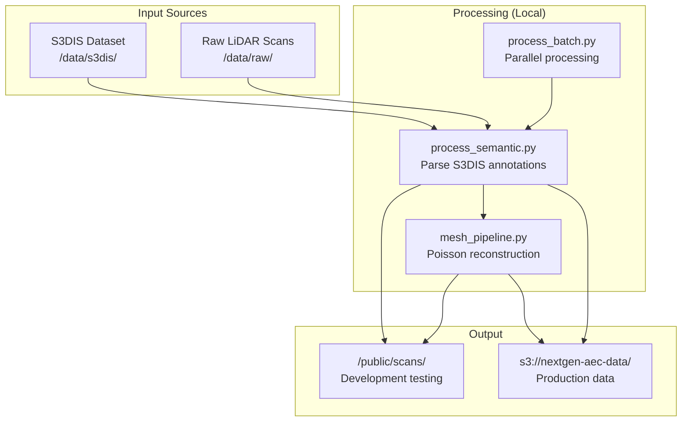
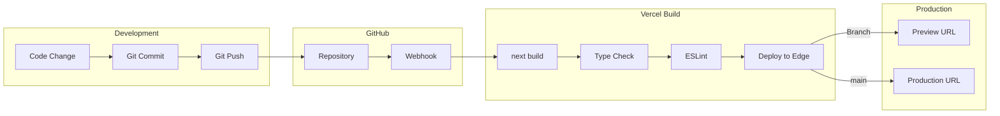
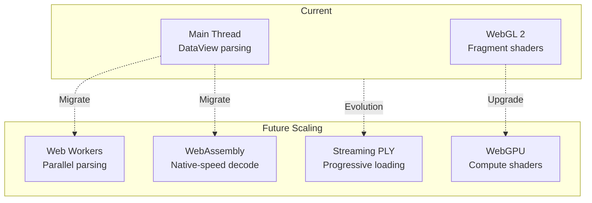

# 07. Deployment View - Infrastructure

**Version**: 1.0.0
**Last Updated**: 2025-12-20
**Status**: Approved

---

## 1. Overview

O NextGen AEC Platform utiliza uma arquitetura de deployment híbrida que combina:
- **Vercel Edge Network**: Frontend Next.js e API Routes
- **AWS S3**: Data Lake para arquivos PLY processados
- **Local Python Scripts**: Processamento offline de datasets



---

## 2. Environment Topology

### 2.1 Development Environment



**Development Stack**:

| Component | Version | Purpose |
|-----------|---------|---------|
| Node.js | 20.x LTS | JavaScript runtime |
| pnpm | 8.x | Package manager |
| Next.js | 16.x | React framework |
| Python | 3.11 | ETL scripts |
| Open3D | 0.18.x | Point cloud processing |

### 2.2 Production Environment



---

## 3. Vercel Deployment Configuration

### 3.1 vercel.json

```json
{
  "framework": "nextjs",
  "regions": ["iad1", "sfo1", "fra1", "sin1"],
  "headers": [
    {
      "source": "/scans/(.*)",
      "headers": [
        { "key": "Cache-Control", "value": "public, max-age=31536000, immutable" },
        { "key": "Access-Control-Allow-Origin", "value": "*" }
      ]
    }
  ],
  "rewrites": [
    {
      "source": "/data/:path*",
      "destination": "https://s3.amazonaws.com/nextgen-aec-data/:path*"
    }
  ]
}
```

### 3.2 Edge Function Configuration

```typescript
// next.config.js
const nextConfig = {
  experimental: {
    serverActions: true,
  },
  images: {
    remotePatterns: [
      { protocol: 'https', hostname: 's3.amazonaws.com' }
    ]
  },
  async headers() {
    return [
      {
        source: '/:path*',
        headers: [
          { key: 'X-Frame-Options', value: 'DENY' },
          { key: 'X-Content-Type-Options', value: 'nosniff' },
          { key: 'Referrer-Policy', value: 'strict-origin-when-cross-origin' }
        ]
      }
    ];
  }
};
```

### 3.3 Build Output

```
.next/
├── static/                 # Hashed static assets
│   ├── chunks/            # JS code-split chunks
│   ├── css/               # CSS modules
│   └── media/             # Static images
├── server/                # Server-side code
│   ├── app/               # App Router pages
│   └── edge-functions/    # Edge runtime
└── cache/                 # Build cache
```

---

## 4. AWS S3 Configuration

### 4.1 Bucket Structure

```
s3://nextgen-aec-data/
├── scans/
│   ├── Area_1/
│   │   ├── conferenceRoom_1.ply      # ~100MB
│   │   ├── conferenceRoom_1_objects.json
│   │   ├── office_1.ply
│   │   ├── office_1_objects.json
│   │   └── ...
│   ├── Area_2/
│   └── ...
├── meshes/
│   ├── conferenceRoom_1.glb          # ~20MB
│   └── ...
└── manifest/
    └── dataset_manifest.json         # Index file
```

### 4.2 Bucket Policy

```json
{
  "Version": "2012-10-17",
  "Statement": [
    {
      "Sid": "PublicReadAccess",
      "Effect": "Allow",
      "Principal": "*",
      "Action": "s3:GetObject",
      "Resource": "arn:aws:s3:::nextgen-aec-data/*",
      "Condition": {
        "StringLike": {
          "aws:Referer": [
            "https://nextgen-aec.vercel.app/*",
            "http://localhost:3000/*"
          ]
        }
      }
    }
  ]
}
```

### 4.3 CORS Configuration

```json
[
  {
    "AllowedHeaders": ["*"],
    "AllowedMethods": ["GET", "HEAD"],
    "AllowedOrigins": [
      "https://nextgen-aec.vercel.app",
      "http://localhost:3000"
    ],
    "ExposeHeaders": ["Content-Length", "Content-Type"],
    "MaxAgeSeconds": 3600
  }
]
```

---

## 5. Python ETL Environment

### 5.1 Environment Setup

```bash
# Create virtual environment
python -m venv .venv

# Activate (Windows)
.venv\Scripts\activate

# Activate (Unix)
source .venv/bin/activate

# Install dependencies
pip install -r requirements.txt
```

### 5.2 requirements.txt

```
open3d==0.18.0
numpy==1.26.2
trimesh==4.0.5
scipy==1.11.4
boto3==1.34.0
python-dotenv==1.0.0
tqdm==4.66.1
```

### 5.3 Processing Workflow



### 5.4 Upload Script

```python
# scripts/upload_to_s3.py
import boto3
import os
from pathlib import Path

def upload_processed_files():
    s3 = boto3.client('s3')
    bucket = 'nextgen-aec-data'
    local_dir = Path('public/scans')

    for file_path in local_dir.glob('**/*.ply'):
        key = f"scans/{file_path.relative_to(local_dir)}"
        print(f"Uploading {file_path} -> s3://{bucket}/{key}")
        s3.upload_file(
            str(file_path),
            bucket,
            key,
            ExtraArgs={
                'ContentType': 'application/octet-stream',
                'CacheControl': 'public, max-age=31536000'
            }
        )

if __name__ == '__main__':
    upload_processed_files()
```

---

## 6. Infrastructure Diagram

```mermaid
flowchart TB
    subgraph Users["End Users"]
        BROWSER["Web Browser<br/>Chrome/Firefox/Safari"]
    end

    subgraph Vercel["Vercel Edge (Production)"]
        direction TB
        DNS["DNS<br/>nextgen-aec.vercel.app"]
        CDN["Global CDN<br/>Edge Caching"]
        EDGE["Edge Functions<br/>API Routes"]
        STATIC["Static Files<br/>JS/CSS/Images"]
    end

    subgraph AWS["AWS (Data Storage)"]
        S3["S3 Bucket<br/>PLY/GLB files"]
    end

    subgraph Dev["Development"]
        LOCAL["localhost:3000<br/>Next.js Dev"]
        PYTHON["Python Scripts<br/>ETL Processing"]
        DATA["Local Data<br/>/public/scans"]
    end

    BROWSER -->|HTTPS| DNS
    DNS --> CDN
    CDN --> EDGE
    CDN --> STATIC
    CDN -->|Cache Miss| S3

    PYTHON --> DATA
    DATA --> LOCAL
    PYTHON -->|Upload| S3

    style Vercel fill:#000,stroke:#fff
    style AWS fill:#FF9900,stroke:#fff
    style Dev fill:#333,stroke:#fff
```



---

## 7. Deployment Pipeline

### 7.1 CI/CD Flow



### 7.2 Deployment Commands

```bash
# Local Development
pnpm dev                    # Start dev server on :3000

# Production Build
pnpm build                  # Generate .next/ output
pnpm start                  # Start production server

# Vercel CLI
vercel                      # Deploy to preview
vercel --prod               # Deploy to production

# Python ETL
python scripts/process_semantic.py input.txt output.ply
python scripts/upload_to_s3.py     # Sync to S3
```

---

## 8. Scaling Considerations

### 8.1 Current Limits

| Resource | Current | Limit | Scaling Strategy |
|----------|---------|-------|------------------|
| PLY file size | 100MB avg | 500MB | Chunk loading, LOD |
| Concurrent users | ~100 | 1000 | Vercel auto-scales |
| S3 bandwidth | 1 TB/mo | 100 TB/mo | CloudFront CDN |
| Edge function | 50ms avg | 30s timeout | Cache, precompute |

### 8.2 Future Architecture



---

## 9. Monitoring & Observability

### 9.1 Vercel Analytics

```typescript
// next.config.js
module.exports = {
  analyticsId: process.env.VERCEL_ANALYTICS_ID,
};

// pages/_app.tsx
import { Analytics } from '@vercel/analytics/react';

export default function App({ Component, pageProps }) {
  return (
    <>
      <Component {...pageProps} />
      <Analytics />
    </>
  );
}
```

### 9.2 Metrics Collected

| Metric | Source | Alert Threshold |
|--------|--------|-----------------|
| Core Web Vitals | Vercel Analytics | LCP > 2.5s |
| Error Rate | Vercel Logs | > 1% |
| Edge Latency | Vercel Metrics | p99 > 200ms |
| S3 4xx/5xx | CloudWatch | > 0.1% |
| Build Time | Vercel CI | > 5 min |

### 9.3 Logging

```typescript
// API route logging
export async function GET(request: Request) {
  console.log({
    event: 'api_request',
    path: request.url,
    timestamp: new Date().toISOString(),
    region: process.env.VERCEL_REGION
  });
  // ...
}
```

---

## 10. Disaster Recovery

### 10.1 Backup Strategy

| Component | Backup Method | Recovery Time |
|-----------|---------------|---------------|
| Source Code | GitHub | Instant (clone) |
| PLY Data | S3 Versioning | < 1 hour |
| Deployment | Vercel Rollback | < 1 min |
| Config | Git (vercel.json) | Instant |

### 10.2 Rollback Procedure

```bash
# Vercel rollback to previous deployment
vercel rollback [deployment-url]

# S3 restore previous version
aws s3api get-object --bucket nextgen-aec-data \
  --key scans/Area_1/conferenceRoom_1.ply \
  --version-id [version-id] \
  restored_file.ply
```

---

## 11. Cost Analysis

### 11.1 Monthly Estimates (Typical Usage)

| Service | Usage | Cost (USD) |
|---------|-------|------------|
| Vercel Pro | 1 project | $20/mo |
| Vercel Bandwidth | 100 GB | Included |
| AWS S3 Storage | 50 GB | $1.15/mo |
| AWS S3 Transfer | 500 GB | $45/mo |
| **Total** | | ~$66/mo |

### 11.2 Cost Optimization

- **PLY Compression**: Reduce S3 storage and transfer
- **Edge Caching**: Reduce S3 requests (max-age=1yr)
- **LOD Loading**: Reduce bandwidth per session
- **Regional Replication**: Avoid cross-region transfer

---

## 12. Related Documentation

- [05. Building Block View](../05_building-block-view/01_whitebox_overall.md) - Architecture
- [06. Runtime View](../06_runtime/01_critical_scenarios.md) - Runtime scenarios
- [08. Technical Concepts](../08_concepts/01_technical_decisions.md) - Design patterns

---

**Document Owner**: Lead Software Architect
**Review Cycle**: Quarterly
**Next Review**: 2026-03-20
