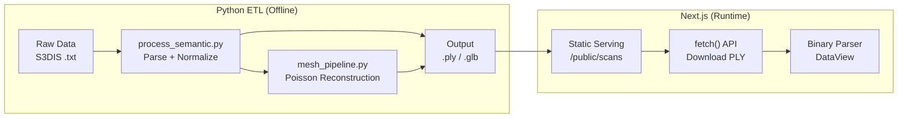
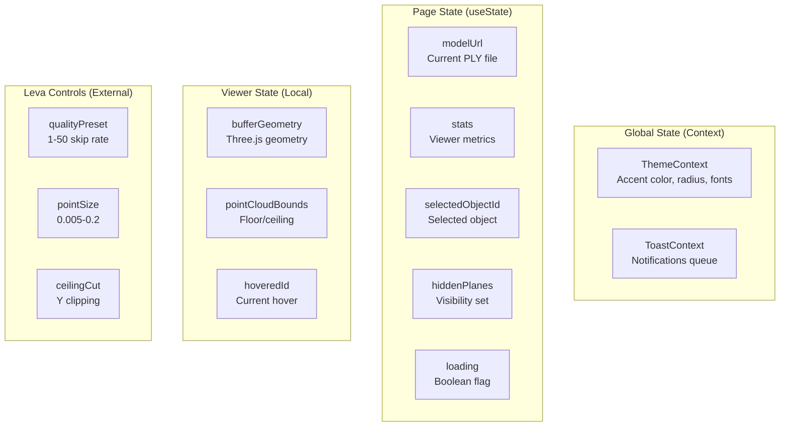

# 08. Cross-Cutting Concepts - Technical Decisions

**Version**: 1.0.0
**Last Updated**: 2025-12-20
**Status**: Approved

---

## 1. Overview

Este documento detalha os padrões arquiteturais, decisões técnicas e conceitos transversais aplicados no NextGen AEC Platform.

---

## 2. Architectural Patterns

### 2.1 Custom Hooks for 3D Logic

**Decisão**: Encapsular toda a lógica 3D complexa em custom hooks React.

**Rationale**:
- Separação clara entre UI e lógica de renderização
- Reusabilidade de comportamentos entre componentes
- Testabilidade isolada de cada hook
- Composição facilitada via hooks

**Implementação**:

```typescript
// Hook Pattern: Single Responsibility
function usePointCloudLoader(fileUrl: string, skipRate: number) {
  const [geometry, setGeometry] = useState<BufferGeometry | null>(null);
  const [stats, setStats] = useState<ViewerStats | null>(null);
  const rawDataRef = useRef<ArrayBuffer | null>(null);

  // Phase 1: Download
  useEffect(() => { /* fetch logic */ }, [fileUrl]);

  // Phase 2: Process (separate effect for different trigger)
  useEffect(() => { /* parse logic */ }, [skipRate, rawDataRef.current]);

  return { geometry, stats, bounds };
}
```

**Hooks Implementados**:

| Hook | Responsabilidade | Dependencies |
|------|------------------|--------------|
| `usePointCloudLoader` | Download e parsing de PLY | fetch API, DataView |
| `useViewerInteraction` | Raycasting e seleção | THREE.Raycaster |
| `useCameraNavigation` | Controle WASD + Q/E | useFrame, keyboard events |

### 2.2 Domain-Driven Design Structure

**Decisão**: Organizar código por features/domínios, não por tipo técnico.

**Rationale**:
- Código relacionado fica junto (coesão)
- Facilita navegação e entendimento
- Suporta crescimento modular
- Alinhamento com bounded contexts

**Estrutura de Pastas**:

```
src/
├── features/              # Bounded Contexts
│   ├── viewer/           # 3D Visualization Domain
│   │   ├── Viewer3D.tsx           # Main component
│   │   ├── BIMOverlay.tsx         # BIM overlay
│   │   ├── hooks/                 # Domain hooks
│   │   │   ├── usePointCloudLoader.ts
│   │   │   ├── useViewerInteraction.ts
│   │   │   └── useCameraNavigation.ts
│   │   ├── materials/             # Shaders
│   │   │   └── LidarMaterial.ts
│   │   ├── components/            # Sub-components
│   │   │   ├── SmartGhosts.tsx
│   │   │   └── ProceduralRoom.tsx
│   │   └── utils/                 # Domain utilities
│   │       └── textureUtils.ts
│   │
│   └── ui/               # UI Domain
│       ├── Header.tsx
│       ├── CombinedSidebar.tsx
│       ├── TelemetryPanel.tsx
│       └── AIInsightsPanel.tsx
│
├── contexts/             # Cross-Cutting State
│   ├── ThemeContext.tsx
│   └── ToastContext.tsx
│
├── lib/                  # Shared Libraries
│   └── lidarGenerator.ts
│
└── types/                # Shared Type Definitions
    └── index.ts
```

**Comparação com Estrutura Tradicional**:

```
# Tradicional (por tipo) - NÃO usado
src/
├── components/      # Todos os componentes misturados
├── hooks/           # Todos os hooks misturados
├── utils/           # Utilities genéricas
└── types/           # Types genéricos

# DDD (por feature) - USADO
src/
├── features/
│   ├── viewer/      # Tudo relacionado a 3D viewer
│   └── ui/          # Tudo relacionado a UI
```

### 2.3 Python for Data Processing

**Decisão**: Usar Python para ETL e processamento pesado de dados LiDAR.

**Rationale**:
- Ecossistema maduro para 3D (Open3D, NumPy, trimesh)
- Performance superior para operações numéricas
- Facilidade de prototipação e experimentação
- Separação clara entre processamento offline e runtime

**Pipeline Architecture**:



**Bibliotecas Python**:

| Biblioteca | Uso | Justificativa |
|------------|-----|---------------|
| `Open3D` | Point cloud processing | Algoritmos otimizados (Poisson, normals) |
| `NumPy` | Array operations | Performance em operações vetorizadas |
| `struct` | Binary encoding | PLY binary format writing |
| `trimesh` | Mesh operations | Simplificação e conversão |

---

## 3. Technical Decisions

### 3.1 Three.js + React Three Fiber

**Decisão**: Usar Three.js via React Three Fiber (R3F) em vez de Three.js vanilla.

**Rationale**:
- Integração nativa com React lifecycle
- Declarative scene management
- Hot module replacement
- Vast ecosystem (@react-three/drei, leva)

**Trade-offs**:

| Aspecto | Three.js Vanilla | React Three Fiber |
|---------|------------------|-------------------|
| Performance | Slightly better | Very close (~2% overhead) |
| DX | Imperative, verbose | Declarative, concise |
| Debugging | Console-based | React DevTools |
| Ecosystem | Mature | Growing, very active |

**Exemplo Comparativo**:

```typescript
// Three.js Vanilla
const scene = new THREE.Scene();
const camera = new THREE.PerspectiveCamera(75, aspect, 0.1, 1000);
const renderer = new THREE.WebGLRenderer();
renderer.setSize(width, height);
document.body.appendChild(renderer.domElement);
const geometry = new THREE.BoxGeometry();
const material = new THREE.MeshBasicMaterial({ color: 0x00ff00 });
const cube = new THREE.Mesh(geometry, material);
scene.add(cube);
function animate() {
  requestAnimationFrame(animate);
  cube.rotation.x += 0.01;
  renderer.render(scene, camera);
}
animate();

// React Three Fiber
function Scene() {
  const ref = useRef();
  useFrame(() => (ref.current.rotation.x += 0.01));
  return (
    <Canvas>
      <mesh ref={ref}>
        <boxGeometry />
        <meshBasicMaterial color="green" />
      </mesh>
    </Canvas>
  );
}
```

### 3.2 TypeScript Strict Mode

**Decisão**: Habilitar `strict: true` no tsconfig.json.

**Rationale**:
- Catch errors at compile-time
- Self-documenting code via types
- Better IDE support (autocomplete, refactoring)
- Reduced runtime errors

**Configuration**:

```json
{
  "compilerOptions": {
    "strict": true,
    "noImplicitAny": true,
    "strictNullChecks": true,
    "strictFunctionTypes": true,
    "noImplicitReturns": true,
    "noFallthroughCasesInSwitch": true
  }
}
```

### 3.3 Binary PLY Format

**Decisão**: Usar formato PLY binário little-endian em vez de ASCII.

**Rationale**:
- 5-10x menor tamanho de arquivo
- Parsing mais rápido (DataView vs string parsing)
- Precisão numérica preservada (float32 vs text)
- Suporte nativo a atributos customizados (objectId)

**Comparison**:

```
ASCII PLY (conferenceRoom_1):
- Size: ~450MB
- Parse time: ~15s
- Format: "1.234 5.678 9.012 255 128 64\n"

Binary PLY (conferenceRoom_1):
- Size: ~100MB (78% reduction)
- Parse time: ~2s (7x faster)
- Format: 18 bytes per vertex
```

### 3.4 Percentile-based Floor/Ceiling Detection

**Decisão**: Usar percentis (1st/99th) em vez de min/max para detectar floor/ceiling.

**Rationale**:
- Outliers (noise, errors) não afetam o cálculo
- Mais robusto para dados reais de LiDAR
- Funciona sem limpeza prévia de dados

**Implementação**:

```typescript
// Sort Y coordinates
const sortedY = yCoords.slice().sort((a, b) => a - b);
const n = sortedY.length;

// 1st percentile (floor)
const floorIndex = Math.floor(n * 0.01);
const floor = sortedY[floorIndex];

// 99th percentile (ceiling)
const ceilingIndex = Math.floor(n * 0.99);
const ceiling = sortedY[ceilingIndex];

// Result: floor = 0.15m, ceiling = 3.02m
// Min/max would give: floor = -2.5m (outlier), ceiling = 8.5m (outlier)
```

### 3.5 Raycasting Throttle Strategy

**Decisão**: Limitar raycasting a 4fps (250ms) em vez de every frame.

**Rationale**:
- Raycasting em point clouds é O(n) - caro para milhões de pontos
- User perception não requer 60fps para hover feedback
- Libera GPU time para rendering

**Implementation**:

```typescript
const RAYCAST_INTERVAL = 0.25; // 4fps
let timeSinceLastRaycast = 0;

useFrame((_, delta) => {
  timeSinceLastRaycast += delta;
  if (timeSinceLastRaycast < RAYCAST_INTERVAL) return;
  timeSinceLastRaycast = 0;

  // Skip if mouse hasn't moved significantly
  if (Math.abs(mouse.x - lastMouse.x) < 0.01 &&
      Math.abs(mouse.y - lastMouse.y) < 0.01) {
    return;
  }

  // Expensive operation - only runs 4x/second
  const intersects = raycaster.intersectObject(points);
  // ...
});
```

---

## 4. Cross-Cutting Concerns

### 4.1 State Management Strategy

**Decisão**: Usar React useState + Context para estado global, sem Redux/Zustand.

**Rationale**:
- Aplicação de tamanho médio, não requer state manager complexo
- React 19 concurrent features melhoram performance
- Menos boilerplate, mais direto
- Context para temas e toasts, props para viewer state

**State Distribution**:



### 4.2 Error Handling Strategy

**Decisão**: Usar try-catch + Toast notifications para erros de usuário, console.error para debug.

**Rationale**:
- Usuário recebe feedback visual imediato
- Desenvolvedor tem stack trace no console
- Aplicação não crasha em erros recuperáveis

**Implementation**:

```typescript
try {
  const response = await fetch(fileUrl);
  if (!response.ok) {
    throw new Error(`HTTP ${response.status}: ${response.statusText}`);
  }
  const buffer = await response.arrayBuffer();
  // ... process
} catch (error) {
  console.error('PLY load error:', error);
  showToast({
    type: 'error',
    message: 'Failed to load point cloud',
    action: { label: 'Retry', onClick: () => loadPLY(fileUrl) }
  });
  // Fallback to demo data
  loadPLY('/api/lidar?demo=true');
}
```

### 4.3 Performance Monitoring

**Decisão**: Implementar telemetry panel com métricas em tempo real.

**Métricas Coletadas**:

| Metric | Source | Update Rate |
|--------|--------|-------------|
| FPS | useFrame clock | 1 Hz |
| Points | BufferGeometry.count | On load |
| Dimensions | Bounds calculation | On load |
| Area/Volume | Derived | On load |
| Draw Calls | renderer.info | 1 Hz |
| Memory | Estimated from points | On load |

### 4.4 Theme System

**Decisão**: Usar CSS variables para theming, injetadas via style prop.

**Rationale**:
- Sem rerender de componentes em theme change
- Suporta dark/light mode
- Customização granular (accent, radius, spacing)

**Implementation**:

```typescript
// ThemeContext.tsx
const themeVariables = {
  '--theme-accent': accentColor,
  '--theme-radius': borderRadius,
  '--theme-spacing': spacing,
  '--theme-font': fontFamily,
  '--theme-glass': 'rgba(0,0,0,0.8)',
};

// Usage in components
<div style={{ background: 'var(--theme-glass)' }} />
```

---

## 5. Design Patterns Used

### 5.1 Observer Pattern (via useFrame)

```typescript
// Observers subscribe to render loop
useFrame((state, delta) => {
  // Called every frame (~60fps)
  updateUniforms(delta);
  checkRaycast(state.mouse);
  animateSelected(state.clock.elapsedTime);
});
```

### 5.2 Factory Pattern (Geometry Creation)

```typescript
function createPointCloudGeometry(data: ParsedPLY): BufferGeometry {
  const geometry = new THREE.BufferGeometry();
  geometry.setAttribute('position', new THREE.BufferAttribute(data.positions, 3));
  geometry.setAttribute('color', new THREE.BufferAttribute(data.colors, 3));
  geometry.setAttribute('objectId', new THREE.BufferAttribute(data.objectIds, 1));
  geometry.computeBoundingBox();
  return geometry;
}
```

### 5.3 Strategy Pattern (Quality Presets)

```typescript
const qualityStrategies = {
  ultra: { skipRate: 1, pointSize: 0.01 },
  high: { skipRate: 2, pointSize: 0.015 },
  medium: { skipRate: 5, pointSize: 0.02 },
  low: { skipRate: 10, pointSize: 0.025 },
  minimal: { skipRate: 50, pointSize: 0.03 }
};

function applyQuality(preset: keyof typeof qualityStrategies) {
  const strategy = qualityStrategies[preset];
  reprocessPLY(strategy.skipRate);
  setPointSize(strategy.pointSize);
}
```

### 5.4 Composite Pattern (Scene Graph)

```tsx
<Canvas>
  {/* Composite: Scene contains multiple children */}
  <Viewer3D>
    <points geometry={geometry} material={material} />
    <BIMOverlay>
      <Plane name="Wall_Left" />
      <Plane name="Wall_Right" />
      <Plane name="Ceiling" />
    </BIMOverlay>
    <SmartGhosts candidates={candidates} />
  </Viewer3D>
  <OrbitControls />
  <gridHelper />
</Canvas>
```

---

## 6. Security Considerations

### 6.1 Input Validation

```typescript
// Validate PLY header before processing
function validatePLYHeader(header: string): void {
  if (!header.startsWith('ply')) {
    throw new Error('Invalid PLY magic number');
  }
  if (!header.includes('binary_little_endian')) {
    throw new Error('Only binary little-endian PLY supported');
  }
  if (!header.match(/element vertex \d+/)) {
    throw new Error('Missing vertex count');
  }
}
```

### 6.2 CORS Configuration

```typescript
// next.config.js
const nextConfig = {
  async headers() {
    return [
      {
        source: '/scans/:path*',
        headers: [
          { key: 'Access-Control-Allow-Origin', value: '*' },
          { key: 'Cache-Control', value: 'public, max-age=31536000' }
        ]
      }
    ];
  }
};
```

### 6.3 No Eval/Dynamic Code

- Nenhum uso de `eval()`, `new Function()`, ou `innerHTML`
- Parsing de PLY usa DataView (binary-safe)
- Shaders são strings estáticas, não user-generated

---

## 7. Related Documentation

- [04. Solution Strategy](../04_solution-strategy/stack.md) - Technology stack
- [05. Building Block View](../05_building-block-view/01_whitebox_overall.md) - Architecture
- [ADR-001: Technology Stack](../09_decisions/ADR-001_technology-stack.md) - Stack decision

---

**Document Owner**: Lead Software Architect
**Review Cycle**: Quarterly
**Next Review**: 2026-03-20
